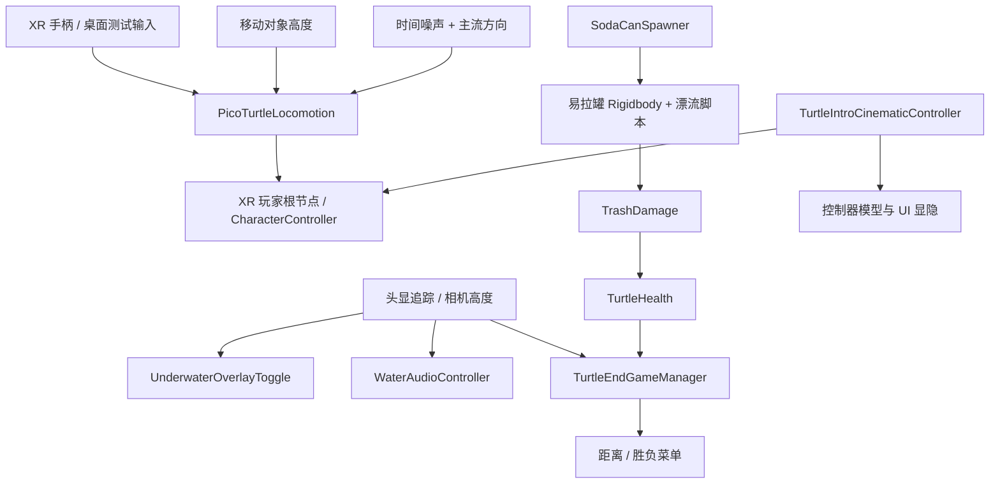

# Turtle World 海龟世界：技术实现深度说明

版本：2026-11-23  
项目：Becoming Non-Human / DECO3009  
用途：作品集技术说明、面试准备、后续调试与重构参考。  
个人贡献：Sitan 负责整体世界规划、三个世界的大纲，并负责海龟世界。本文重点解释海龟实现，不将全部团队代码或第三方资产认定为个人独立原创。

> **阅读前提：本文基于压缩包中的 C# 源码、TurtleScene 场景序列化数据、相关 Prefab 与最终报告。未启动 Unity、运行 APK 或进行头显测试。** “场景实际配置”指提交包中的序列化值，不表示运行中不会被其他组件覆盖。风险分析是静态推断，不等于已经复现的 Bug。
>
> 本次进一步检查发现，代码默认值与场景设置差异很大。涉及技术行为时，应优先使用本文的“场景值与证据”，不能继续直接采用前一份网站 brief 中关于“受伤间隔”等概括。

## 目录

1. 系统目标与架构
2. 证据、版本与关键脚本
3. 状态与每帧执行流程
4. XR 身体、相机与坐标系
5. 输入、陆地移动和水下移动
6. 玩家洋流：噪声、强度和多层平滑
7. 垃圾随机生成与刚体漂流
8. 水位判定与水上／水下视觉
9. 声音切换和低通滤波
10. 开场动画到第一人称游玩的切换
11. 碰撞、生命值与身体高度
12. 距离、胜负与结束菜单
13. 场景值和代码默认值总表
14. 当前限制、风险与验证步骤
15. 后续架构优化建议
16. 作品集与面试表述
17. 素材与演示证据清单
18. 源文件索引与场景参数摘录

---

## 1. 系统目标与架构

海龟世界把一个清晰的任务——“避开海洋垃圾并抵达岸边”——拆成了多个协同系统：

- **主动移动**：玩家通过手柄控制方向、转向和升降。
- **被动漂移**：洋流向主动移动结果叠加额外速度。
- **环境障碍**：随机分布的易拉罐在水中漂流和转动。
- **视听状态**：越过水位后，切换水下遮罩、环境声和背景音乐滤波。
- **结果反馈**：生命值、目标距离、成功／失败菜单。
- **体验阶段**：开始界面、导览动画、正式游玩、结束界面。

这不是一套统一的物理海洋模拟器，而是一组围绕体验目标设计的行为系统。玩家移动用 CharacterController，垃圾运动用 Rigidbody；二者分别计算洋流，不共享一个空间流场。



图中的连接用于解释已检查的脚本关系；物理碰撞是否全部正常触发，仍取决于 Layer、Tag、Collider 和运行状态。

## 2. 证据、版本与关键脚本

### 2.1 工程环境

- Unity：2022.3.20f1。
- URP 依赖：14.0.12，GraphicsSettings 指向渲染管线资产。
- PICO：项目包含本地 PICO Unity Integration SDK 3.4.0 依赖。
- OpenXR：1.14.3。
- XR Interaction Toolkit：2.5.2。
- Input System：1.7.0；`activeInputHandler = 2`，即新旧输入后端同时启用。
- 物理固定时间步：`0.02` 秒，名义频率 50 Hz。
- Android 目标架构：ARM64。

这些版本记录的是提交工程，不构成新的升级建议。

### 2.2 模块清单

| 脚本 | 职责 | 本次看到的使用证据 |
|---|---|---|
| `PicoTurtleLocomotion.cs` | 手柄输入、游泳／陆地移动、玩家洋流 | TurtleScene 有启用实例 |
| `TurtleIntroCinematicController.cs` | 开场动画、XR Rig 跟随、游玩交接 | 有启用实例，开场时长 20 秒 |
| `UnderwaterOverlayToggle.cs` | 根据相机高度显隐水下遮罩 | 有启用实例，水位 36.9 |
| `UnderwaterEffectController.cs` | 旧 Volume 权重与雾方案 | 场景实例被禁用 |
| `WaterAudioController.cs` | 环境音量切换和 BGM 低通 | 有启用实例 |
| `SodaCanSpawner.cs` | 随机生成易拉罐并设置漂流参数 | 有启用实例 |
| `SodaCanOceanDrift.cs` | 每个易拉罐的物理漂流、旋转和范围约束 | 生成器会获取或动态添加 |
| `TrashDamage.cs` | 垃圾接触玩家时调用伤害 | 生成器会获取或动态添加 |
| `TurtleHealth.cs` | 生命值、受伤保护状态、生命 UI | 有启用实例 |
| `TurtleEndGameManager.cs` | 距离、胜负、结束菜单与重开 | 有启用实例 |
| `ControllerVisualManager.cs` | 左右手柄可见模型显隐 | 有启用实例 |
| `PlayerDamageHitbox.cs` | 玩家侧的垃圾触发伤害检测 | 有源码，未找到场景直接绑定或 Prefab 引用 |
| `XRGameplayColliderPatch.cs` | 固定身体高度与受伤碰撞区域 | 有源码，未找到场景直接绑定或 Prefab 引用 |

**不能因为一个脚本存在，就断言它正在参与最终运行。** 后两项只能作为已有方案／工具代码讨论，不能写成确定已启用的修复。

## 3. 状态与每帧执行流程

系统可以从两个不同维度理解。

### 3.1 体验阶段

```text
开始界面
  → StartIntro()
开场动画（场景配置 20 秒）
  → FinishIntro()
正式游玩
  → 生命值耗尽 / 进入终点距离
成功或失败菜单
  → 重开当前场景 / 返回菜单
```

这是一种基于多个布尔量、组件开关和 GameObject 显隐的隐式状态机，不是统一的 `enum GameState` 状态管理器。

### 3.2 移动状态

```text
isSwimming = true  → HandleSwim()
isSwimming = false → HandleLand()
```

每次 `PicoTurtleLocomotion.Update()` 的主要顺序：

1. 尝试重新获取失效的 XR 手柄设备。
2. 读取左右手柄轴和桌面测试输入。
3. 在允许的平台处理鼠标视角。
4. 更新水上／水下移动状态。
5. 执行游泳或陆地移动。

视觉和音频由其他 MonoBehaviour 自己在 `Update()` 中判断，因此**不存在一个被所有系统共同使用的唯一水下状态**。

这既方便快速原型开发，也带来同步问题：移动、视觉、声音可能在同一时刻对“是否在水下”给出不同答案。

## 4. XR 身体、相机与坐标系

### 4.1 三个必须区分的对象

- **XR Origin / 玩家根节点**：游戏通过脚本移动的整体坐标基准。
- **Main Camera**：受到头显追踪影响的真实观察位置，随用户站立、坐下、俯身而改变。
- **CharacterController**：参与游戏碰撞和移动的胶囊体，不会天然等于头显位置。

概念关系：

```text
相机世界位置 ≈ XR Origin 世界变换 × 相机追踪局部变换
```

玩家根节点静止时，用户低头、蹲下或移动头部仍可能改变相机世界高度。因此“身体位于水下”和“眼睛位于水下”不是同一个判定。

### 4.2 当前绑定

- 移动脚本的 `xrCamera` 指向 Main Camera。
- `waterCheckPoint` 未绑定，因此移动状态取脚本所在对象的 `transform.position.y`。
- 水下遮罩取 Main Camera 高度。
- 声音控制器同样取 Main Camera 高度，因为 `useWaterCheckPoint = false`。
- 结束管理器的 `player` 指向相机 Transform，因此终点距离按头部位置计算。

### 4.3 “视角切换”不是简单换一台相机

检查到的主要代码并没有执行“第三人称相机关闭、第一人称相机开启”的完整双相机切换流程。

它主要通过三种方式改变体验：

1. **移动 XR Origin 的控制权切换**：开场动画跟随目标 → 玩家移动脚本。
2. **相机前效果切换**：水上无遮挡 → 水下半透明遮罩。
3. **辅助物体显隐**：开场海龟模型、控制器可见模型、开始／游戏／结束 UI。

因此更准确的描述是：**同一 XR 观察体系在导览、自由控制和水下表现之间切换状态。**

## 5. 输入、陆地移动和水下移动

### 5.1 XR 输入映射

`UnityEngine.XR.InputDevices.GetDeviceAtXRNode` 获取左右手柄。

| 输入 | 用途 |
|---|---|
| 左手柄 `primary2DAxis.x` | 左右移动 |
| 左手柄 `primary2DAxis.y` | 前后移动 |
| 右手柄 `primary2DAxis.x` | 转向 |
| 右手柄 `primary2DAxis.y` | 水中上下移动 |

死区 `stickDeadZone = 0.15`。左手柄按二维向量长度判断，右手柄 X、Y 分量分别判断，略有不同。

### 5.2 桌面测试输入

在 `UNITY_EDITOR || UNITY_STANDALONE` 条件下：

- Horizontal / Vertical：左右和前后。
- Q / E：转向。
- Space：上升。
- LeftControl 或 C：下降。
- 鼠标：调整观察／转向，用于非头显调试。

这是开发便利功能，不说明当前 Android APK 可以直接在网页或桌面运行。

场景 `mouseLookPivot` 未绑定，因此鼠标上下俯仰的设置分支没有对应 Pivot 可写入；不能仅依据脚本提供 Pitch 字段，就宣称桌面完整上下看已经配置。

### 5.3 陆地移动

相机 forward 和 right 向量投影到水平面：

```text
forward.y = 0
right.y = 0
move = ClampMagnitude(normalize(forward) × inputY
                    + normalize(right) × inputX, 1)
```

因此用户抬头不会让陆地行走飞向天空。

实际场景：
- 速度：1.3 Unity 距离单位／秒。
- 转向速度：56.8 度／秒。
- 重力：-18。
- 接地向下速度：-2，用于保持贴地。

移动通过 `CharacterController.Move(finalMove * deltaTime)` 完成；CharacterController 不会自动施加重力，重力在脚本中累加。

### 5.4 游泳移动

游泳使用完整相机 forward/right，不投影到水平面：

```text
swimDirection = ClampMagnitude(cameraForward × inputY
                             + cameraRight × inputX, 1)
targetSwim = swimDirection × swimMoveSpeed
           + worldUp × verticalInput × swimVerticalSpeed
```

这意味着：抬头向前游会带有上升分量；还可以额外用右摇杆增加垂直运动。

实际场景：
- `swimMoveSpeed = 2.4`。
- `swimVerticalSpeed = 1`。
- `swimTurnSpeed = 42.9`。
- `swimSmooth = 9.45`。

主动速度不是立即赋值，而是：

```csharp
swimVelocity = Vector3.Lerp(
    swimVelocity, targetSwim, swimSmooth * Time.deltaTime);
```

持续输入改变时，速度逐步追近目标，减弱瞬时变化。但它不是严格的恒定加速度模型，也不是与帧率完全无关的精确指数平滑。

`Lerp` 的 t 会限制在 0–1。如果某帧 `swimSmooth × dt >= 1`，这一帧会直接到目标。

此外，水平／前后游泳和额外升降相加后没有再次统一限速，因此组合输入的总速度可能大于 `swimMoveSpeed`，不能把 2.4 写成严格的最终最大速度。

## 6. 玩家洋流：噪声、强度和多层平滑

### 6.1 设计目标

洋流需要让玩家感到自己处于持续变化的水体中，同时避免每帧完全随机造成的高频抖动。

当前实现采用：

**多层连续噪声方向 + 固定主流方向 + 独立强度变化 + 平滑处理。**

关键公式：

```text
最终游泳速度 = 平滑后的主动速度 + 平滑后的洋流漂移速度
最终位移 = 最终游泳速度 × deltaTime
```

这里洋流对玩家是额外**速度**，不是 `Rigidbody.AddForce` 意义上的物理力。

### 6.2 初始随机种子

`Start()` 为 X/Y/Z 和强度分别生成 0–1000 范围内的随机 seed。

意义：不同进入场景的运行，不一定出现同样的漂流变化。

限制：没有看到固定 seed 的复现实验接口。要比较调参效果，建议在未来增加可指定 seed 的模式；当前不要声称测试轨迹完全可复现。

### 6.3 第一层噪声

令 `t = Time.time × driftNoiseSpeed`，每轴取不同的 Perlin Noise 采样位置：

```text
nX1 = 2 × Perlin(seedX, t) - 1
nY1 = 2 × Perlin(seedY, t + 13.7) - 1
nZ1 = 2 × Perlin(seedZ, t + 27.1) - 1
```

`×2−1` 把原本约 0–1 的输出映射到约 -1–1，使漂流可以朝正负方向变化。

不同偏移避免三个轴使用完全相同的节奏。

### 6.4 第二、第三层

第二层改变种子偏移、时间频率与相位：X/Y/Z 时间频率分别使用 0.73、0.81、0.69 倍。

第三层再加入另一组变化：分别使用 1.17、1.09、0.93 倍频率。

每个轴的组合方式一致：

```text
n12 = Lerp(n1, n2, driftBlend)
n = Lerp(n12, n3, 0.35)
```

场景 `driftBlend = 0.639`，代入后的名义权重：

```text
n ≈ 0.23465 × n1 + 0.41535 × n2 + 0.35 × n3
```

它是几层噪声的加权混合，不是将三层直接相加，因此不会仅因层数增加而把振幅机械放大三倍。

### 6.5 三轴强度与主流

```text
layeredDrift = (nX × strengthX, nY × strengthY, nZ × strengthZ)
baseCurrent = normalize(baseCurrentDirection) × baseCurrentStrength
current = layeredDrift + baseCurrent
```

实际场景：

| 参数 | 场景值 | 作用 |
|---|---:|---|
| driftStrengthX | 2.34 | 横向变化幅度 |
| driftStrengthY | 2.48 | 垂直变化幅度 |
| driftStrengthZ | 2.39 | 前后变化幅度 |
| driftNoiseSpeed | 1.09 | 方向变化的时间尺度 |
| driftBlend | 0.639 | 第二层噪声权重 |
| baseCurrentDirection | (0.4, 0.08, 0.5) | 主流方向，内部会归一化 |
| baseCurrentStrength | 0.65 | 主流速度强度 |

注意，场景垂直幅度 2.48 **不小于**水平幅度，不能沿用默认值 0.35 所暗示的“垂直只轻微摆动”。实际舒适度应通过头显验证。

### 6.6 强度也随时间变化

另一个 Perlin Noise 控制强弱：

```text
mTarget = Lerp(0.8, 1.8, Perlin(seedM, Time.time × 0.35))
m = Lerp(m, mTarget, 2 × deltaTime)
```

然后：

```text
driftTarget = current × m
currentDrift = Lerp(currentDrift, driftTarget, 3.93 × deltaTime)
```

玩家洋流包含两层额外平滑：先平滑强度，再平滑合成后的向量；再加上独立的主动速度平滑，一共三个追随环节。

以 90fps 为例，单帧插值因子约为：主动移动 0.105、洋流向量 0.0437、洋流强度 0.0222。这只是按当前参数计算的说明，不表示已经测得该工程稳定运行在 90fps。

### 6.7 它不是什么

- 不是 CFD、Navier–Stokes 求解或真实海况重建。
- 不采样玩家的世界空间位置；主要是时间与随机种子驱动。
- 不会自然形成“靠岸区域较弱、深水区域较强”的空间分区。
- 玩家与罐子没有共用相同的 seed 或同一个流场采样函数。
- `enableWaterDrift=false` 使目标漂移变为零，但已有 `currentDrift` 仍通过 Lerp 逐渐衰减，不一定这一帧完全停止。

准确表述：**通过多层噪声和可调主流方向模拟持续变化的水下漂移，给导航增加环境阻力。**

## 7. 垃圾随机生成与刚体漂流

### 7.1 生成数量不是默认的几十个

`SodaCanSpawner` 的代码默认值为 25–45；**TurtleScene 实际设为 1400–2000**，整数随机范围含两端。

这对性能和场景拥挤程度影响很大。本文记录该事实，不推断设计者为什么选这个数量，也不声称已经测量帧率。

### 7.2 生成区域

X/Z 在矩形范围内随机，Y 由海平面减去深度决定。

场景：

```text
center XZ = (817.3, 1909)
size XZ = (277, 219.1)
seaLevel = 36.5
minDepth = 1.07
maxDepth = 12.5
```

对应范围：

- X：678.8 到 955.8。
- Z：1799.45 到 2018.55。
- Y：24.0 到 35.43。

`spawnCenter.y` 和 `spawnSize.y` 虽然有 Inspector 值，但 `GetRandomSpawnPosition()` 并不使用它们计算 Y。理解参数时不要把 Inspector 中整个 Vector3 当成最终生成盒。

当前算法没有看到生成前重叠检查，也没有避开玩家出生点、终点或场景几何体的逻辑。

### 7.3 每个实例的初始化

生成器会：

1. Instantiate 指定罐子 Prefab，并随机旋转。
2. 获取或添加 `SodaCanOceanDrift`。
3. 给漂流速度、噪声节奏、翻滚、回拉等参数赋随机值。
4. 设置 Rigidbody：关闭重力，drag=1，angularDrag=0.9，mass=0.35，启用 Interpolate。
5. 将找到的子 Collider 设为 Trigger。
6. 获取或添加 `TrashDamage`，设置每次伤害 1，碰撞后不销毁。

注意：`GetComponentsInChildren<Collider>()` 默认不包含 inactive 子物体，不能据此断言所有隐藏碰撞体都被改为 Trigger。

### 7.4 垃圾使用“加速度”，与玩家不同

`SodaCanOceanDrift.FixedUpdate()` 使用：

```csharp
rb.AddForce(current, ForceMode.Acceleration);
rb.AddTorque(torque, ForceMode.Acceleration);
```

因此它通过物理步累积速度，并受到阻尼、碰撞和其他物理设置影响。`ForceMode.Acceleration` 的这项加速不会因为 mass=0.35 而按 F/m 放大。

玩家的 `currentDrift` 则直接作为速度叠加，二者参数单位和运动感不可直接等同。

### 7.5 漂流、翻滚与上下浮动

- 平移：三轴各三层 Perlin Noise，加主流方向。
- 旋转：三轴各两层 Perlin Noise，乘 torqueStrength。
- 强弱：独立噪声在实例自己的 Min/Max 之间变化。
- 上下浮动：`sin(Time.time × 1.4 + bobSeed) × bobForce`，作为额外垂直加速度。

生成器为不同罐子分配不同参数，因此它们不会整齐地同向同步移动。

### 7.6 范围与水面限制

**范围回拉**：距离出生位置超过随机 6–12 单位后，施加朝原点的回拉加速度，强度随机 0.25–0.5。

它不是硬性半径边界；超过范围后还会因为惯性继续运动，再逐渐受力返回。

**水面限制**：

```text
maxAllowedY = seaLevelY − surfaceOffset = 36.35
```

- 已超过该高度：直接把刚体位置压回，并清除正向 Y 速度。
- 接近水面但未越过：按距离逐渐施加向下加速度。

这是保持垃圾在水下的游戏约束，不是物理浮力模型。直接改 `rb.position` 的分支有可能产生可见位置修正，需要实际观察。

### 7.7 性能含义

每个罐子的一个物理步至少包含约 16 次 Perlin Noise 调用：强度 1 次、平移 9 次、旋转 6 次。

在当前 1400–2000 数量、50Hz 物理频率下，若所有实例启用且持续更新，名义上仅这些噪声就约为 **112 万–160 万次／秒**，另有大量 Rigidbody、Trigger 与绘制开销。

这是静态调用次数估算，不是 Profiler 结果。不能直接据此宣布“必然卡顿”，但应优先在 Pico 上测 CPU 物理耗时、碰撞事件量、渲染批次和帧率。

## 8. 水位判定与水上／水下视觉

### 8.1 移动状态的判定

当前启用严格模式：

```csharp
float currentY = waterCheckPoint != null
    ? waterCheckPoint.position.y
    : transform.position.y;
isSwimming = currentY < seaLevelY;
```

场景 `waterCheckPoint=null`、`seaLevelY=37`、`useStrictSeaLevel=true`。

进入游泳时清空陆地垂直速度；离开游泳时清空游泳速度、漂移和强度状态。之后会进入 HandleLand，继续用重力处理陆地移动。

### 8.2 代码有缓冲，但当前没启用

非严格模式才使用 `switchBuffer=0.15`：

- 已在水中，超过 `seaLevel+buffer` 才离开。
- 已在陆地，低于 `seaLevel-buffer` 才进入。

这形成迟滞区，减少水面附近反复切换。当前 `useStrictSeaLevel=true`，所以不能说最终场景已经用了这项防抖。

### 8.3 最终遮罩方案

`UnderwaterOverlayToggle` 使用相机高度：

```text
cameraY < 36.9 → underwaterOverlay.SetActive(true)
cameraY ≥ 36.9 → underwaterOverlay.SetActive(false)
```

场景中的遮罩是 Main Camera 子对象：
- localPosition = (0,0,0.35)。
- localRotation 为单位旋转。
- localScale = (100,100,100)。

这说明它会随相机移动，位于相机前方。材质、双眼投影、近裁面、透明排序和遮挡效果仍需要运行验证；只凭 Transform 不足以证明视觉完全正确。

遮罩脚本使用每帧 SetActive，不是平滑透明度渐变，也没有迟滞区。

### 8.4 旧 Volume/Fog 方案

工程保留 `UnderwaterEffectController`，可以把 Volume weight 逐步变到 0／1，并切换全局雾。

**但 TurtleScene 中该组件 `m_Enabled=0`。** 不能同时把它与最终遮罩都描述为当前水下效果的有效来源。

报告称采用遮罩是为改善 Pico 中后处理不稳定的问题；这是团队报告的设计取舍记录，而不是本次实机对比测试结论。

### 8.5 当前状态不同步的具体原因

| 系统 | 取哪个高度 | 阈值 |
|---|---|---:|
| 移动 | 玩家根节点（未绑定 waterCheckPoint） | 37.0 |
| 水下遮罩 | Main Camera | 36.9 |
| 声音 | Main Camera | 36.9 |
| 垃圾生成／水面约束 | 自己的海平面设置 | 36.5 |

阈值差只有 0.1 并不意味着影响必然很小，因为相机相对根节点还有真实头高偏移。

例如根节点 Y=36.8、相机 Y=38.0 时，移动可以已经处于游泳状态，而声音和画面仍被判为水上。这个例子是用于说明逻辑，不是本次测得的玩家坐标。

## 9. 声音切换和低通滤波

### 9.1 三个声源的分工

| 声源 | 含义 | 控制方式 |
|---|---|---|
| AboveWaterAmbience | 水上环境氛围 | 水上有声，水下衰减为 0 |
| UnderwaterAmbience | 水下环境氛围 | 水上为 0，水下提升 |
| BGM | 背景音乐 | 始终播放，按状态调整音量与低通 |

场景三个 AudioSource 都开启 Loop、关闭 PlayOnAwake；脚本 Start 会对未播放的声源调用 Play。

这不是每次入水重新播放音频，而是让声源持续运行，再调整权重。这样可以减少切换时重复从文件开头开始的问题。

### 9.2 实际音量矩阵

| 参数 | 水上 | 水下 |
|---|---:|---:|
| 水上环境音 | 0.22 | 0 |
| 水下环境音 | 0 | 0.68 |
| BGM 音量 | 0.26 | 0.34 |
| BGM 低通截止频率 | 22000 Hz | 209.8 Hz |

重要修正：**当前场景 BGM 入水后目标音量更高，而不是更低。** 虽然其高频被大幅滤除，主观上可能更闷，但不能将代码默认的 0.45→0.35 当成实际场景值。

低通只绑定到 `bgmLowPassFilter`，不能写“所有声音经过同一个低通”或者“整个 AudioMixer 被滤波”。

### 9.3 Start 时的初始化

Start 先把声音设为水上组合：Above=0.22、Underwater=0、BGM=0.26、Cutoff=22000。

后续 Update 才按相机高度修正。因此若场景加载时相机已在水下，初始几帧可能从水上声音过渡进去。这是代码顺序造成的可能性，需实际听感验证。

AudioSource Inspector 自身的 volume 值会被此初始化覆盖，不应拿它们当成最终水上音量。

### 9.4 音量是 MoveTowards，不是 Lerp

```csharp
source.volume = Mathf.MoveTowards(
    source.volume, targetVolume, volumeLerpSpeed * Time.deltaTime);
```

场景 `volumeLerpSpeed=2`，表示每秒最多改变 2 个线性 volume 单位。

在状态保持、无其他脚本覆盖时，近似完成时间：

| 变化 | 时间 |
|---|---:|
| 水上环境音 0.22→0 | 0.11 秒 |
| 水下环境音 0→0.68 | 0.34 秒 |
| BGM 0.26→0.34 | 0.04 秒 |

这是不同声源分别朝目标移动，不是等功率交叉淡化。总响度未必恒定，也没有对当前响度进行感知归一化。

### 9.5 低通变化速度

```csharp
cutoffFrequency = Mathf.MoveTowards(
    cutoffFrequency, targetCutoff,
    filterLerpSpeed * 10000f * Time.deltaTime);
```

场景 `filterLerpSpeed=100`，对应每秒 1,000,000 Hz 的最大变化量。

22000→209.8 的差值约 21790.2 Hz，理想计算只需约 **0.0218 秒**，在常见帧率下只占很少几帧。

所以虽然使用了渐变函数，不能在作品集中描述成“缓慢、柔和的滤波淡入”。它在当前配置下相当迅速，是否会产生明显音色突变需要实听。

### 9.6 为什么低通能暗示水下

它衰减较高频率，保留较低频成分，使音乐听起来更闷、更不清晰。这里是为了建立易识别的视听反馈，并非对真实水下声传播进行物理建模。

不要宣称双耳定位、HRTF 或真实水下声速模拟；当前检查的声源 `Spatialize=0`，也未看到这段控制器处理传播距离或介质声速。

### 9.7 音频异常的排查顺序

1. 检查 Main Camera 引用是否有效。
2. 看相机世界 Y 是否跨越 36.9。
3. 确认三个 AudioSource 的 Clip 与 Loop。
4. 看运行时 volume，而不是只看编辑前 Inspector 初值。
5. 确认低通滤波器挂在实际 BGM 声源上。
6. 查看滤波是否被其他组件覆盖。
7. 在水面附近上下移动，观察是否反复切状态。
8. 在头显中分别检查站姿、坐姿和低头时表现。

## 10. 开场动画到第一人称游玩的切换

### 10.1 开场准备

`TurtleIntroCinematicController.Start()`：

1. 把 Animator 播放到 `TurtleIntro` 第一帧。
2. `Animator.Update(0)` 立即采样该帧。
3. Animator speed=0，暂停。
4. 将 XR Origin 对齐 IntroFollowTarget。
5. 显示 IntroCanvas，隐藏 GameplayUIRoot。
6. 隐藏开场用海龟模型。
7. 禁用玩家 Locomotion 和 CharacterController。
8. 显示手柄模型，允许开始界面的可见交互提示。

这里“允许开始操作”还依赖实际 UI 事件与 XR 交互组件；不是仅显示手柄模型就自动可点。

### 10.2 开始动画

`StartIntro()`：隐藏开始／游戏 UI，显示开场海龟模型，隐藏控制器视觉模型，并将左右控制器根对象 SetActive(false)。

随后开启 Animator、设定 `introPlaying=true`，启动协程，等待 `introDuration`。

场景值 **20 秒**，不是脚本默认的 12 秒。

### 10.3 镜头如何跟随动画

`LateUpdate()` 中：

```csharp
xrOrigin.position = introFollowTarget.position;
xrOrigin.rotation = introFollowTarget.rotation;
```

Animator 驱动路径目标，XR Origin 每帧跟随它。使用 LateUpdate 有利于在动画更新后应用跟随，但具体执行顺序仍应在 Unity 中核对。

移动的是整个 Rig，不是强行抹掉头显的局部追踪。用户仍可能在导览过程中通过头部转动改变观察方向，具体由 XR 配置决定。

**舒适度含义**：系统驱动视点运动，但真实身体没有相同运动，可能引发不适。这是需要头显测试的风险，不能用“动画流畅”替代舒适性验证。

### 10.4 正式游玩的交接

20 秒等待结束后调用 `FinishIntro()`：

- 关闭 `introPlaying`，停止路径跟随。
- 把 XR Origin 位置移动到 GameplayStartPoint。
- **不覆盖 rotation**，代码明确希望避免结束时突然反向。
- 隐藏开场海龟模型。
- 重新启用左右控制器根对象。
- 重新启用 CharacterController 和 Locomotion。
- 显示 GameplayUIRoot。
- 隐藏控制器可见模型，但保留控制器功能。

场景 GameplayStartPoint 为 `(807,14,2002)`，旋转记录约为 Y=180°，但 FinishIntro 不应用它的旋转。因此不能说“游玩起点的旋转值决定最终朝向”。

### 10.5 定时器与动画事件的区别

报告说明曾经使用 Animation Event 调用 FinishIntro，后来因不稳定改为固定时长。

当前代码的主要路径是 `WaitForSeconds(introDuration)`，它受 Time.timeScale 影响。如果动画时长被更改但 introDuration 不变，二者可能失配。

也没有看到 Skip Intro、淡入淡出遮罩或重复 FinishIntro 的明确状态保护，不能把这些当成既有功能。

### 10.6 控制器显示不等于控制器启用

| 阶段 | 控制器根对象 | 可见模型 |
|---|---|---|
| 开始菜单 | 取决于场景初始状态 | 显示 |
| 开场动画 | 关闭 | 隐藏 |
| 正式游玩 | 开启 | 隐藏 |
| 结束菜单 | 不由结束管理器关闭 | 显示 |

`ControllerVisualManager` 只负责视觉根对象，不直接处理移动输入。

## 11. 碰撞、生命值与身体高度

### 11.1 当前明确接通的伤害路径

```text
SodaCanSpawner
  → 获取或添加 TrashDamage
  → 垃圾 Trigger 与玩家发生接触
  → other 必须具有 Player Tag
  → 在碰撞对象或父级寻找 TurtleHealth
  → TakeDamage(1)
```

垃圾 Prefab 与层级配置会影响 Trigger 是否产生事件；不能只检查函数存在就保证碰撞正确。

### 11.2 生命值流程

- 最大生命值：5。
- Start 重设 currentHealth=maxHealth。
- 伤害会减少生命值，最小限制为 0。
- 到 0 后 `isDead=true`。
- UI 文本更新为 `Health: 当前 / 最大`。

没有看到被动回血、氧气、持续饥饿或计时死亡系统，不应写进现有玩法。

### 11.3 无敌时间的关键修正

脚本默认 `invincibleTime=1`，但场景实例为 **0**。

因此当前版本不能准确描述为“有一秒受伤保护”。非致命伤害后仍会暂时把 canTakeDamage 设为 false，但下次执行相关 Update 时计时器已经可恢复，无法提供预期的一秒缓冲。

这不意味着单个持续接触一定每帧扣血，因为 `TrashDamage` 使用的是 OnTriggerEnter，不是 OnTriggerStay。多个罐子、多个碰撞体或反复进入仍需要测试。

### 11.4 另一套 Hitbox 代码

`PlayerDamageHitbox` 支持从玩家侧检查 `trash` Tag，并在 Enter/Stay 时施加伤害，默认冷却 0.6 秒。

本次没有在场景直接实例或 Prefab 文本中找到它的引用。没有运行时动态挂载证据时，不能将 0.6 秒写成最终实际伤害冷却。

如果未来把它与 `TrashDamage` 同时启用，需要检查是否形成重复伤害通路。

### 11.5 身体尺寸与真实头高

场景中对应 CharacterController 的 Prefab override 包含：

```text
height = 2.96
center = (0,0.43,0)
```

它明显不同于“低矮海龟身体”的直觉尺寸；但坐标单位与模型比例需要实际查看，不能仅凭数字直接判断外观。

报告记录的主要问题是：相机代表人的头部，游戏碰撞体却代表另一个空间范围。用户觉得已经碰到罐子时，胶囊体可能还未接触；扩大胶囊体可提高接触概率，却可能削弱低视角效果。

### 11.6 已存在但未证实启用的修补方案

`XRGameplayColliderPatch` 的设计：
- 在 LateUpdate 固定 CharacterController 高度与中心。
- 可让中心 XZ 在有限范围内跟随头部。
- 限制最大水平跟随距离。
- 单独调整 damageHitbox 的高度与水平位置。
- 带 DefaultExecutionOrder(1000)，意图较晚覆盖身体设置。

本次未找到其场景／Prefab 绑定，不能将这段逻辑描述为“当前问题已经解决”的证据。

## 12. 距离、胜负与结束菜单

### 12.1 距离提示

`TurtleEndGameManager` 场景中：
- player 指向相机。
- use3DDistance=true。
- reachDistance=2.5。

因此：

```text
distance = |cameraWorldPosition − goalWorldPosition|
```

显示 `Distance: x.x m`，保留一位小数。这里 m 是项目 UI 的单位标签，不证明整个模型场景经过真实尺度校准。

距离是直线距离，不是沿可行走路径的剩余距离，也不是箭头式方向导航。

三维距离包含高度差。即使水平上已经接近岸边，相机高度与目标高度差较大时，仍可能不满足 2.5 的条件。

### 12.2 胜负优先级

Update 先判断死亡，再计算抵达目标。

同一帧同时满足死亡与抵达时，按当前顺序会优先进入失败处理。这是代码流程，不是已验证的设计意图。

结束时：
- 设置 hasEnded=true，阻止重复结算。
- 隐藏游戏 HUD。
- 禁用 TurtleLocomotion。
- 显示控制器模型。
- 显示胜利或失败面板。

注意：只禁用 Locomotion 并不等于暂停所有系统。垃圾刚体、声音、头部追踪与其他脚本可能继续运行。

### 12.3 菜单在视野前方的定位

菜单位置从相机 forward 计算，场景配置：

```text
menuDistance = 1.6
menuVerticalOffset = -0.05
flattenForwardOnY = true
```

flattenForwardOnY 会先将 forward.y 清零并归一化，使菜单大体放在用户水平视线前方，避免因为用户低头就放到地面。

菜单先 LookAt 相机，再绕 Y 旋转 180°，这是为了配合 UI 平面的正反面方向。必须在头显中确认文字是否正面可读。

菜单是在 ShowEndMenu 时定位一次，并没有在该脚本 Update 中持续跟随头部。

### 12.4 重开与返回菜单

- RestartScene：加载当前场景 buildIndex。
- BackToMenu：按字符串 menuSceneName 加载。
- 场景值 menuSceneName=`MainMenu`。
- 当前 Build Settings 中没有 MainMenu，只有 intro、Bat、Spider、Turtle、End 五个场景。

是否会触发返回失败，取决于实际按钮是否绑定 BackToMenu，以及运行时是否修改该字符串。静态检查应标为待核对，不能声称已复现。

## 13. 场景值和代码默认值总表

| 参数 | 代码默认 | TurtleScene | 解释影响 |
|---|---:|---:|---|
| landMoveSpeed | 2.0 | 1.3 | 陆地速度更低 |
| swimMoveSpeed | 1.8 | 2.4 | 主动游泳更快 |
| swimVerticalSpeed | 1.2 | 1.0 | 手动垂直速度 |
| swimSmooth | 4 | 9.45 | 主动输入跟随更快 |
| driftStrengthX | 0.75 | 2.34 | 横向漂移更强 |
| driftStrengthY | 0.35 | 2.48 | 垂直漂移显著提高 |
| driftStrengthZ | 0.75 | 2.39 | 前后漂移更强 |
| driftNoiseSpeed | 0.75 | 1.09 | 方向变化更快 |
| driftSmooth | 3 | 3.93 | 向量跟随更快 |
| baseCurrentStrength | 0.45 | 0.65 | 主流更强 |
| introDuration | 12 | 20 | 交接等待更长 |
| audio seaLevelY | 28.9 | 36.9 | 不能照抄代码水位 |
| bgmAboveVolume | 0.45 | 0.26 | 实际水上音量 |
| bgmUnderwaterVolume | 0.35 | 0.34 | 实际入水后反而比水上高 |
| bgmUnderwaterCutoff | 1200 Hz | 209.8 Hz | 高频衰减更强 |
| filterLerpSpeed | 3.5 | 100 | 音色切换很快 |
| min/maxSpawnCount | 25–45 | 1400–2000 | 场景负载大幅提高 |
| invincibleTime | 1 秒 | 0 秒 | 不存在默认的一秒保护 |
| destroyAfterHit（生成器） | false | false | 罐子不因一次命中销毁 |
| UnderwaterEffectController enabled | 脚本存在 | false | 旧后处理不是当前有效路径 |

## 14. 当前限制、风险与验证步骤

以下是具体的验证计划，不是已经完成的测试报告。

### 14.1 水面附近状态一致性

记录 rootY、cameraY、isSwimming、overlayActive、音量、cutoff。

操作：站姿／坐姿分别缓慢升降、低头、穿过水面。

检查：是否出现已经开始陆地重力但仍看到水下遮罩；是否只有转头或蹲下就切声音；是否在阈值附近频繁闪烁。

### 14.2 开场控制权

从开始按钮触发到 20 秒结束，观察：
- 手柄根节点关闭后是否影响开始流程以外的必要交互。
- 动画是否恰好在计时完成时结束。
- FinishIntro 是否被动画事件和协程重复调用。
- Rig 位置是否跳变，最终朝向是否合适。
- 游戏 UI 是否曾因多个 Start 方法互相覆盖而提前显示。

TurtleEndGameManager.Start 会显示 GameplayUIRoot，而 IntroController.Start 会隐藏它；若没有明确执行顺序，这里存在初始化顺序风险。

### 14.3 洋流强度与舒适度

分别关闭洋流、只开水平、再加垂直，比较漂移、到达率与主观不适。不要同时改多个参数后归因。

使用固定 seed 才容易重现同一漂流条件；当前没有现成接口，需要未来开发。

### 14.4 垃圾性能

在 50、200、500、1400、2000 数量下记录：主线程、物理步、绘制、GC 和设备帧率。

测试与产品发布配置分开，不直接为了展示而改原始项目。若没有 Profiler，不写“优化提升百分之多少”。

### 14.5 伤害与终点

- 一次进入一个罐子，是否只扣 1。
- 持续停留是否继续伤害。
- 多个罐子同帧接触是否符合预期。
- 生命值到 0 的失败是否只触发一次。
- 终点在不同头高下是否可达。
- 成功／失败后是否还有其他移动组件继续影响玩家。
- Restart 与 BackToMenu 是否都可用。

### 14.6 声音

分别录制入水与出水：环境音切换、BGM 音色、音量变化。观察是否有突变、重复重播、无声间隙或音量叠加。

本项目未见对整个声音系统进行真实水下声学验证，作品集应描述交互反馈意图。

## 15. 后续架构优化建议（未实现）

### 15.1 将身体状态与感官状态显式分开

不一定要求所有系统用同一个高度点。更合理的模型可以是：

- BodyInWater：决定游泳／陆地移动。
- HeadUnderwater：决定遮罩和声音。

但应统一管理两个状态的来源、阈值和迟滞，明确预期差异，而不是多个脚本各自维护难以追踪的海平面数值。

### 15.2 提取共享水体配置

未来用配置资产集中记录 seaLevel、迟滞、声音参数和边界。垃圾水面偏移可以与玩家感官阈值不同，但要有明确理由和命名。

### 15.3 洋流模块化

提取 `SampleCurrent(position, time, seed)`：
- 支持空间变化。
- 可选共享玩家／垃圾的流场。
- 分离“模拟流场”和“角色响应强度”。
- 支持固定种子测试。

这将是重构方向，不能写成当前已有架构。

### 15.4 减少实例级物理成本

考虑对象池、分区激活、远处垃圾简化、减少 Rigidbody 数量、多个物体共享噪声样本。选择方案前必须先测瓶颈。

### 15.5 状态机统一开场与结束

用明确状态协调输入、碰撞、HUD、音频与控制器显示，避免多个 Start 相互覆盖。引入可重复调用保护与可选跳过导览机制。

### 15.6 舒适性设置

可探索较低垂直洋流、较缓和的转向、可选择的转向模式、导览跳过等。每项必须与实际头显测试相结合，不能承诺完全消除晕动。

## 16. 作品集与面试表述

### 16.1 一段完整中文技术概述

> 我负责整体世界规划及三个世界的大纲，并负责海龟世界的设计与实现。海龟移动使用 CharacterController，将手柄输入与多层噪声驱动的洋流漂移叠加；环境垃圾则通过独立的刚体漂流与随机分布形成动态障碍。水下状态通过高度判定触发视觉遮罩、环境音量变化及背景音乐低通滤波。开场阶段由动画路径控制 XR Origin，结束后交还玩家移动控制，结合生命值、距离提示与胜负界面形成导航闭环。实现过程中也暴露出头显位置与身体碰撞不一致、状态判定分散等问题，这些成为后续完善的重点。

### 16.2 English technical summary

> I was responsible for the overall world planning and outlines of all three worlds, as well as Turtle World. Its locomotion combines controller input with layered-noise current drift through a CharacterController, while floating rubbish uses separate Rigidbody-based motion. Height checks trigger an underwater overlay, ambience transitions and a low-pass filter on the background music. The introduction moves the XR Origin along an animated path before handing control back to the player. Health, distance feedback and win/fail states complete the navigation loop. The prototype also exposed alignment issues between head tracking, collision geometry and independently evaluated water states.

### 16.3 可以讲的技术亮点

- 把主动输入和环境漂移分开，再合成最终移动。
- 使用多层噪声避免完全独立逐帧随机造成的抖动。
- 分离玩家 CharacterController 与垃圾 Rigidbody 的响应机制。
- 用视觉遮罩、环境声与 BGM 音色共同提示水下状态。
- 开场动画与玩家控制之间进行 Rig 控制权交接。
- 从真实的头部高度／碰撞差异中识别 VR 原型限制。

### 16.4 不应使用的说法

| 不准确说法 | 更准确的表达 |
|---|---|
| 实现真实海洋物理模拟 | 用多层噪声模拟变化的水下漂移 |
| 相机自动在第三人称和第一人称之间切换 | 开场路径控制 XR Rig，随后交还玩家控制 |
| 所有声音经过水下滤波 | 切换环境声，并对 BGM 应用低通滤波 |
| 使用一秒无敌时间避免连续受伤 | 代码支持保护时间，但提交场景设为 0，需要进一步调整 |
| 垃圾总数只有 25–45 | 默认值如此，提交场景配置为 1400–2000 |
| 碰撞补丁已经解决身高问题 | 有补丁源码，未找到启用证据；报告仍列为问题 |
| 最终版本已验证舒适且无 Bug | 有五人形成性测试，仍存在已知局限，未完成本次实机验证 |

## 17. 素材与演示证据清单

建议录制 6 组短片，每组证明一个明确机制：

1. **输入与漂移**：不操作时的漂流、主动修正方向；记录当前参数。
2. **水位切换**：画面与声音同步录制，展示从水下到水面再返回。
3. **垃圾运动**：同一视角观察多个罐子的漂流与翻滚。
4. **伤害反馈**：接触垃圾前后生命值变化，不用剪辑伪造一次受伤效果。
5. **视角交接**：开始界面、动画、进入可控阶段的连续过程。
6. **终点闭环**：距离变化、成功／失败以及实际可用的重开按钮。

每组都应来自当前运行版本。参数截图只能证明配置，不能替代行为录屏。声音演示发布时默认不自动播放。

## 18. 源文件索引与参数证据

### 18.1 原始来源

原始压缩包：`/Volumes/1TB 移动固态/作品集/学校作品集/3009/DECO3009_A3a_Empty Group3.zip`。

内部 Unity 包：`3009 group3.zip`。本次没有修改原包、Unity 资产或脚本。

以下为包内路径：

| 文件 | 建议重点查看的方法 |
|---|---|
| `Assets/Turtle_Level/Script/PicoTurtleLocomotion.cs` | Update、ReadInput、UpdateWaterState、HandleLand、HandleSwim、GetWaterDrift、GetCurrentMagnitudeMultiplier |
| `Assets/script/SodaCanSpawner.cs` | SpawnSodaCans、GetRandomSpawnPosition |
| `Assets/script/SodaCanOceanDrift.cs` | FixedUpdate、GetCurrentForce、GetCurrentTorque、ApplySeaSurfaceLimit |
| `Assets/script/WaterAudioController.cs` | Start、Update |
| `Assets/script/UnderwaterOverlayToggle.cs` | Update |
| `Assets/script/UnderwaterEffectController.cs` | Start、Update（旧方案） |
| `Assets/script/TurtleIntroCinematicController.cs` | Start、StartIntro、LateUpdate、FinishIntroAfterDelay、FinishIntro |
| `Assets/script/ControllerVisualManager.cs` | ShowControllerVisuals、HideControllerVisuals |
| `Assets/Turtle_Level/Script/TrashDamage.cs` | OnTriggerEnter |
| `Assets/Turtle_Level/Script/TurtleHealth.cs` | TakeDamage、Update、UpdateHealthUI |
| `Assets/script/TurtleEndGameManager.cs` | Update、GetDistanceToGoal、HandleWin、HandleFail、PlaceMenuInFrontOfPlayer |
| `Assets/script/PlayerDamageHitbox.cs` | TryDamage（未确认启用） |
| `Assets/script/XRGameplayColliderPatch.cs` | LateUpdate（未确认启用） |
| `Assets/Scenes/TurtleScene.unity` | MonoBehaviour 值、引用、Prefab overrides |
| `ProjectSettings/TimeManager.asset` | 物理时间步 |
| `ProjectSettings/EditorBuildSettings.asset` | 实际打包场景列表 |

### 18.2 读这份文档时的证据边界

- 文中算法来自上述代码；参数来自场景实例时已明确标出。
- “未找到绑定”来自直接场景及 Prefab 文本搜索，不排除其他运行时代码动态添加，因此不写绝对“永远不会运行”。
- 报告关于真实体验的判断属于团队测试记录；本文没有重新开展用户测试。
- 源码和场景可能不是 APK 的同一个打包时刻，二者一致性未校验。
- 文档里的推算时间、调用次数、坐标示例用于解释，不冒充实测性能或体验结果。
- 后续 Unity 有修改时，应重新核对 Scene YAML，避免继续使用过期参数。

### 18.3 关键场景参数原始摘录

下方摘录保留字段名，省去 GUID 与对象 ID。`m_Enabled` 仅代表组件启用标记，还需结合对象层级和运行状态判断。

#### PicoTurtleLocomotion (1 direct scene instances)

```yaml
  m_Enabled: 1
  seaLevelY: 37
  useStrictSeaLevel: 1
  switchBuffer: 0.15
  stickDeadZone: 0.15
  landMoveSpeed: 1.3
  landTurnSpeed: 56.8
  gravity: -18
  groundedStickForce: -2
  swimMoveSpeed: 2.4
  swimVerticalSpeed: 1
  swimTurnSpeed: 42.9
  swimSmooth: 9.45
  enableWaterDrift: 1
  driftStrengthX: 2.34
  driftStrengthY: 2.48
  driftStrengthZ: 2.39
  driftNoiseSpeed: 1.09
  driftSmooth: 3.93
  driftBlend: 0.639
  baseCurrentDirection: {x: 0.4, y: 0.08, z: 0.5}
  baseCurrentStrength: 0.65
  currentMagnitudeMin: 0.8
  currentMagnitudeMax: 1.8
  currentMagnitudeNoiseSpeed: 0.35
  currentMagnitudeSmooth: 2
  enableMouseLook: 1
  mouseYawSpeed: 120
  mousePitchSpeed: 90
  minPitch: -60
  maxPitch: 60
  allowKeyboardInEditor: 1
```

#### TurtleIntroCinematicController (1 direct scene instances)

```yaml
  m_Enabled: 1
  introStateName: TurtleIntro
  introDuration: 20
```

#### UnderwaterOverlayToggle (1 direct scene instances)

```yaml
  m_Enabled: 1
  seaLevelY: 36.9
```

#### UnderwaterEffectController (1 direct scene instances)

```yaml
  m_Enabled: 0
  seaLevelY: 36.5
  blendSpeed: 3
  controlFog: 1
  underwaterFogColor: {r: 0.18, g: 0.42, b: 0.5, a: 1}
  underwaterFogMode: 3
  underwaterFogDensity: 0.18
```

#### WaterAudioController (1 direct scene instances)

```yaml
  m_Enabled: 1
  useWaterCheckPoint: 0
  seaLevelY: 36.9
  aboveWaterTargetVolume: 0.22
  underwaterTargetVolume: 0.68
  bgmAboveVolume: 0.26
  bgmUnderwaterVolume: 0.34
  volumeLerpSpeed: 2
  filterLerpSpeed: 100
  bgmAboveCutoff: 22000
  bgmUnderwaterCutoff: 209.8
```

#### SodaCanSpawner (1 direct scene instances)

```yaml
  m_Enabled: 1
  minSpawnCount: 1400
  maxSpawnCount: 2000
  spawnCenter: {x: 817.3, y: 3.81, z: 1909}
  spawnSize: {x: 277, y: 35.7, z: 219.1}
  seaLevelY: 36.5
  minDepthBelowSea: 1.07
  maxDepthBelowSea: 12.5
  keepBelowSeaLevel: 1
  surfaceOffset: 0.15
  downwardForceNearSurface: 0.8
  nearSurfaceRange: 1
  ensureTrashDamage: 1
  damageAmount: 1
  destroyAfterHit: 0
  spawnOnStart: 1
  clearOldChildrenBeforeSpawn: 1
```

#### SodaCanOceanDrift (0 direct scene instances)

未发现直接序列化的场景实例；这不排除运行时动态添加。是否由生成器添加或存在于 Prefab，应结合上文对应模块说明判断。

#### PlayerDamageHitbox (0 direct scene instances)

未发现直接序列化的场景实例；这不排除运行时动态添加。是否由生成器添加或存在于 Prefab，应结合上文对应模块说明判断。

#### XRGameplayColliderPatch (0 direct scene instances)

未发现直接序列化的场景实例；这不排除运行时动态添加。是否由生成器添加或存在于 Prefab，应结合上文对应模块说明判断。

#### TurtleHealth (1 direct scene instances)

```yaml
  m_Enabled: 1
  maxHealth: 5
  currentHealth: 5
  invincibleTime: 0
```

#### TrashDamage (0 direct scene instances)

未发现直接序列化的场景实例；这不排除运行时动态添加。是否由生成器添加或存在于 Prefab，应结合上文对应模块说明判断。

#### TurtleEndGameManager (1 direct scene instances)

```yaml
  m_Enabled: 1
  menuDistance: 1.6
  menuVerticalOffset: -0.05
  flattenForwardOnY: 1
  reachDistance: 2.5
  use3DDistance: 1
  menuSceneName: MainMenu
```

#### ControllerVisualManager (1 direct scene instances)

```yaml
  m_Enabled: 1
```
